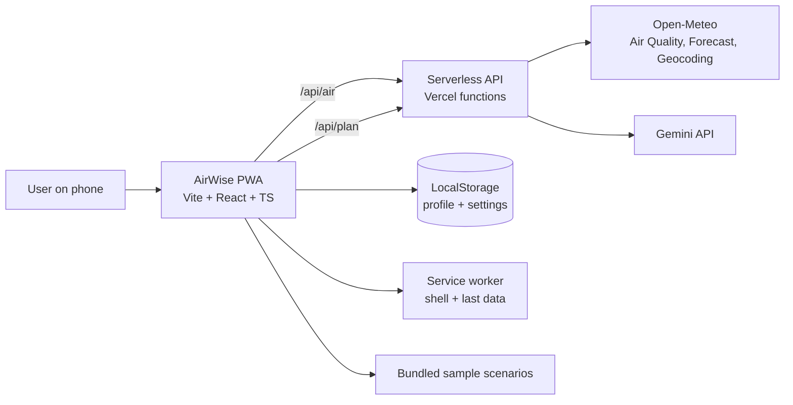
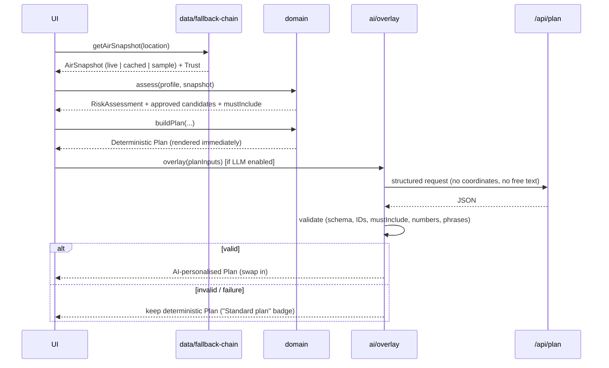

# AirWise Architecture

## 1. Principles

1. **Deterministic core, AI overlay.** Safety, ranking, and numbers live in pure TypeScript. The LLM only selects among approved actions, orders within slots, and writes short explanations.
2. **Layered, one-way dependencies.** `domain` imports nothing from the app. `data` and `ai` import `domain`. `ui` imports `domain`, `data`, `ai` types and `state`. Enforced by an ESLint import-boundary rule.
3. **Always usable.** Every external dependency (air API, weather API, LLM, geolocation, network) has a defined fallback.
4. **Privacy by structure.** No accounts, no names, no free text to the model, no coordinates to the model.
5. **Small and boring.** Few dependencies. No database. No chart library.

## 2. System context

## 3. Runtime decision flow

The deterministic plan renders first. The AI result swaps in when and if it validates. Latency and cold starts are therefore invisible to the user.

## 4. Modules

### `src/domain` (pure, no I/O, 100% unit-testable)
| Module | Responsibility |
|---|---|
| `types.ts` | Shared types and Zod schemas. |
| `config/bands.ts` | PM2.5 → base level per region profile, with source notes. |
| `config/thresholds.ts` | Freshness windows, P-16 commute threshold, defaults. |
| `levels.ts` | Base level, effective level (P-02), level names. |
| `freshness.ts` | Fresh/aging/stale/none from timestamps. |
| `trend.ts` | Rising/steady/falling from hourly series. |
| `radar.ts` | Most vulnerable member × highest-risk slot. |
| `ventilation.ts` | Closed/brief/open verdict and window selection (P-05…P-07). |
| `catalog/` | Static action catalog with impact specs and template keys. |
| `policy.ts` | Candidate filtering, mustInclude, forbidden set (P-01…P-21). |
| `plan-builder.ts` | Complete deterministic plan from candidates. |
| `impact.ts` | Formulas E1, E2, X1, C1; qualitative impact statements. |
| `confidence.ts` | `min(evidence, freshness, dataType)` rule. |
| `quickchecks.ts` | Deterministic answers to common questions. |
| `templates.ts` | Plain-language text keyed by template key, with i18n keys. |

### `src/data`
| Module | Responsibility |
|---|---|
| `providers/openMeteoAir.ts`, `openMeteoWeather.ts`, `geocode.ts` | Thin adapters behind interfaces; Zod-parse responses. |
| `fallback-chain.ts` | Primary → backup → cache → sample, producing a Trust record. |
| `cache.ts` | TTL cache (client) with explicit timestamps. |
| `samples/` | `clear.json`, `moderate.json`, `severe.json`, `stale.json`, and a tiny city list. |
| `trust.ts` | Builds the Trust Panel model (source, data type, freshness, fallback, notes). |

### `src/ai`
| Module | Responsibility |
|---|---|
| `client.ts` | Calls `/api/plan`; timeout and abort handling. |
| `prompts/` | Versioned prompt builders; `PROMPT_VERSION`. |
| `schema.ts` | Zod schema for model output. |
| `validator.ts` | Seven validator checks, all deterministic. |
| `overlay.ts` | Merge validated output onto the deterministic plan; enforce the confidence ceiling. |
| `plan-cache.ts` | Cache by `hash(profile)+hourBucket+dataSignature+PROMPT_VERSION`. |

### `api/` (serverless, thin)
| Endpoint | Role |
|---|---|
| `air.ts` | Validates query, fetches Open-Meteo, normalizes, caches, rate-limits. |
| `plan.ts` | Validates body (Zod), builds prompt server-side from enums, calls Gemini with JSON mode, returns raw JSON. Never logs request bodies. |
| `health.ts` | Liveness and LLM-enabled flag. |
| `_lib/` | Rate limiter, validation, headers, error mapper. |

### `src/ui`
Screens (Today, Indoor, Move, Impact, Community, Onboarding), shared components (RiskBadge, ActionCard, ImpactCard, TrustPanel, QuickChecks, Sparkline), Severe Mode layout, error boundaries per tab.

## 5. Key design details

**Levels.** `base = bandLookup(pm25, regionProfile)`. `effective = min(4, base + (hasSensitiveMember ? 1 : 0))`. Region profile is chosen from the location's country, overridable in Settings.

**Slots.** `early-morning`, `commute-out`, `daytime`, `commute-back`, `evening`, `night`, derived from the routine times. Each slot has an exposure weight (outdoor activity and mode) and a forecast level from the hourly series.

**Radar.** For each member and slot: `score = vulnerabilityWeight(member) × slotForecastLevel × outdoorFactor(slot, mode)`. Highest score wins. The result is a ranking, not a health risk estimate, and is described that way.

**Ventilation.** Applies P-05…P-07 and picks the lowest-forecast hour in the day. If none qualifies, the verdict is *closed*.

**Plan builder.** Takes approved candidates, assigns each to the slot where it matters, and ranks by urgency, feasibility and cost fit, free-first for free budgets. Ensures mustInclude and top-3 composition (at least one exposure action and, where available, one emissions action).

**Impact.** Static `ImpactSpec` per action in the catalog; `impact.ts` resolves it with profile and snapshot (formulas, confidence). The UI only renders what the engine returns, so impact cannot be invented in the view layer.

**LLM overlay.** The server constructs the prompt from the validated body. The client never sends prompt text. Output is parsed, schema-validated server-side and again client-side (defence in depth).

## 6. Caching

| Cache | Key | TTL | Notes |
|---|---|---|---|
| Server air | rounded lat/lon + date-hour | 10 min | Reduces provider calls. |
| Client air | rounded lat/lon | 15 min | Persisted for offline; timestamp always shown. |
| Plan | profile hash + hour bucket + data signature + PROMPT_VERSION | Hour bucket | Avoids repeat LLM calls. |
| Service worker | App shell + last air snapshot | n/a | Offline support. |

## 7. Error taxonomy

`DataUnavailable`, `DataStale`, `ProviderSchemaError`, `LlmUnavailable`, `LlmInvalid`, `GeolocationDenied`, `StorageUnavailable`, `RateLimited`, `ValidationError`. Each maps to a user-visible state in the README's degradation table and has a test.

## 8. Security architecture

Boundary validation with Zod on both ends; CSP with `connect-src 'self'`; secrets only in serverless env; no `dangerouslySetInnerHTML`; model output rendered as text; per-IP rate limit; body-size cap; no request-body logging; privacy-preserving location rounding; CI secret scan and dependency audit. See README §20 and `docs/security-checklist.md`.

## 9. Testing architecture

Pure domain code is tested without mocks. Policy matrix enumerates scenarios programmatically. The LLM client is mocked with fixtures (good, malformed, malicious, partial). Providers are tested against recorded JSON fixtures. Playwright runs against `vite preview` with the sample provider and `LLM_PROVIDER=none`, plus one run with a mocked `/api/plan`.

## 10. Deployment

Vercel (static + serverless) with environment variables set in the dashboard; preview deployments from `main`. Because only one branch is allowed, deploy production from `main` and use local runs for experiments. The repo must also run locally with `npm run dev` and no keys.

## 11. Performance model

Initial route loads only Today. Other tabs are lazy chunks. Sparkline is inline SVG. Domain computations are O(members × slots), trivial. LLM call is a single request with a compact JSON prompt. Budgets and checks are in README §22.
