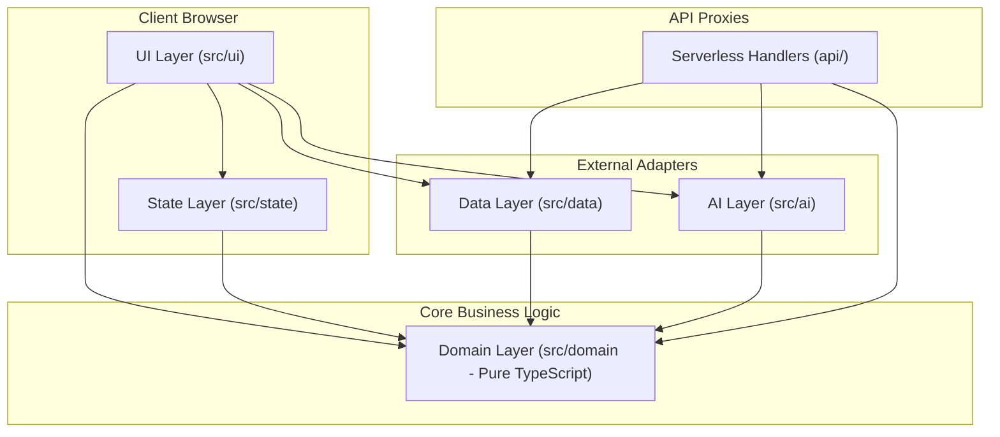

# AirWise

> Household clean-air decision assistant for urban winter smog: understand your air, protect your family, and track dual-axis impact.

AirWise bridges the gap between public air quality indices and household daily decisions. Instead of stopping at a single abstract AQI number or offering generic chatbot advice, AirWise combines local atmospheric forecasts with household profiles to generate a prioritized, explainable Clean-Air Plan. It operates with honest dual-axis impact accounting (exposure reduction vs. emissions avoidance), visible data confidence, and works without API keys (rules-only mode); live air data needs network. An offline shell/PWA is not implemented.

**Documentation Index:** [`docs/README.md`](./docs/README.md) · [`ARCHITECTURE.md`](./docs/ARCHITECTURE.md) · [`BUILD_PLAN.md`](./docs/BUILD_PLAN.md) · [`DECISIONS.md`](./docs/DECISIONS.md) · [`IMPACT_METHODOLOGY.md`](./docs/IMPACT_METHODOLOGY.md) · [`SECURITY_PRIVACY.md`](./docs/SECURITY_PRIVACY.md) · [`DATA_SOURCES.md`](./docs/DATA_SOURCES.md) · [`ACCESSIBILITY.md`](./docs/ACCESSIBILITY.md) · [`TEST_PLAN.md`](./docs/TEST_PLAN.md) · [`Lighthouse Evidence`](./docs/evidence/lighthouse.md)

---

## What It Does

During winter smog, millions of households check AQI numbers but cannot turn them into actionable decisions:
- *Can my asthmatic child walk to school or play outside today?*
- *When is the safest time to ventilate the home?*
- *I cannot afford an air purifier—what low-cost steps actually work?*
- *Does carpooling protect my family's lungs, or only reduce city emissions?*

AirWise answers these questions with:
1. **Household Risk Radar:** Pinpoints the most vulnerable member and their highest-risk exposure window (e.g. child during the 7:30–8:15 AM school run).
2. **Dual-Axis Impact Explainer:** Separates Exposure Reduction (protecting yourself) from Emissions Avoidance (reducing collective pollution). Every action carries explicit labels (*Estimated* or *Recommended*), assumptions, and boundary disclosures.
3. **Smart Ventilation Advisor:** Evaluates hourly PM2.5 forecast hours and data freshness to recommend safe, brief ventilation windows or advise keeping windows closed.
4. **Severe Smog & Low-Cost Modes:** High-contrast, distraction-free view during hazardous smog, and free-first prioritization for households without purifiers, AC, or kitchen exhaust.
5. **Trust Panel:** Displays data provenance (Open-Meteo / CAMS modeled data), observation freshness, and degrades plan confidence when data is stale.
6. **Community Action:** Privacy-preserving collective pledges and copy-ready society notice-board briefings with zero personally identifiable data.

---

## Chosen Vertical

AirWise targets **urban air quality and everyday household decision-making during winter smog**. Its primary users are urban families and households—including households with vulnerable members (children, older adults, or people with asthma/COPD, heart conditions, or pregnancy) and budget-constrained homes without mechanical air purifiers or exhaust fans. Rather than leaving families with raw AQI scores, AirWise translates PM2.5 forecasts and household context into clear, prioritized daily routines covering ventilation timing, indoor cleaner-room setup, protective gear, and commute adjustments.

## Approach and Logic

- **Deterministic policy engine decides safety:** Pure TypeScript rules (`P-01` to `P-22` in `src/domain`) evaluate PM2.5 concentrations, data freshness, household vulnerabilities, heating/cooking equipment, and budget to determine risk levels, mandatory precautions, and candidate actions.
- **Gemini acts only as a bounded overlay:** When `LLM_PROVIDER=gemini` is enabled, the model receives anonymized enums and pre-approved action IDs (no names, coordinates, or free-text chat) solely to reorder approved actions and write brief household explanations.
- **Strict validation and fail-closed fallback:** Every model output passes a Zod schema check and eight deterministic validator rules (`checkSchema`, `checkIds`, `checkMustInclude`, `checkLinks`, `checkBannedPhrases`, `checkReadingLevel`, `checkConfidenceCeiling`, and `checkNumbers`); any failure falls back immediately to the deterministic plan.
- **Dual-axis impact accounting:** Every action separates **Exposure** (what household members breathe) from **Emissions** (pollution caused by the household), always disclosing confidence, assumptions, and what the action does not change (see [`docs/IMPACT_METHODOLOGY.md`](./docs/IMPACT_METHODOLOGY.md) and [`docs/DECISIONS.md`](./docs/DECISIONS.md)).

## Assumptions

- **Modelled CAMS data via Open-Meteo, not ground sensors:** Air quality and weather forecasts come from Open-Meteo (CAMS global modelled domain, ~25 km spatial resolution, 1–3 hourly series updated every 12–24 h). Readings are labelled *Modelled* or *Sample* (the *Measured* label is unused in the MVP), Open-Meteo exposure confidence is capped at *medium*, and stale or missing data forces *low* confidence ([`docs/DATA_SOURCES.md`](./docs/DATA_SOURCES.md), [`docs/DECISIONS.md`](./docs/DECISIONS.md) ADR-007).
- **Impact figures are estimates with stated limits and ranges:** Quantitative outputs (`E1` vehicle-km avoided bounded to 0–100 km one-way and 0–14 round trips/week with 2-person default carpool occupancy and 2 default carpool/remote days, `X1` commute window means shown only when difference is ≥ 5 µg/m³ and ≥ 15%, and `C1` community totals using fixed demo seed parameters) are labelled *Estimated* with visible formulas and assumptions; all other advice is qualitative (*Recommended*), and CO₂e (`E2`) remains disabled (`SHOW_CO2E = false`) until emission factors are sourced ([`docs/IMPACT_METHODOLOGY.md`](./docs/IMPACT_METHODOLOGY.md), [`docs/DATA_SOURCES.md`](./docs/DATA_SOURCES.md)).
- **Profile and state remain in `localStorage`:** Household profiles (with rounded coordinates to 2 decimal places / ~1.1 km and coarse health flags), preferences, and cached air snapshots are stored unencrypted in browser `localStorage` with an in-memory fallback, no user accounts or database, and JSON export / delete-all controls in the menu ([`docs/DECISIONS.md`](./docs/DECISIONS.md) ADR-008, ADR-009).
- **Informational guidance, not medical diagnosis:** AirWise provides non-clinical exposure guidance with fixed clinician-plan and respirator cautions, never medical diagnosis, medication, dosing, or guaranteed health outcomes ([`docs/IMPACT_METHODOLOGY.md`](./docs/IMPACT_METHODOLOGY.md), [`docs/DECISIONS.md`](./docs/DECISIONS.md) ADR-019).
- **India-focused defaults:** Initial fallback location defaults to New Delhi (`IN`), preset profiles and sample cities target Indian urban contexts, regional PM2.5 bands default to India CPCB breakpoints applied over a 6-hour rolling mean (switching to US EPA when a US location/override is active), and rules model local housing and commute realities such as LPG/biomass cooking without exhaust, combustion heating, two-wheelers, and auto-rickshaws ([`docs/DATA_SOURCES.md`](./docs/DATA_SOURCES.md)).

---

## How It Works

AirWise is designed around a **deterministic core with an optional AI overlay**:

```
[ Atmospheric Forecast ] + [ Household Profile ]
               │
               ▼
┌────────────────────────────────────────────────────────┐
│  Pure Deterministic Policy Engine (src/domain)         │
│  - Evaluates rules P-01 to P-22 (shared rule modules)  │
│  - Filters approved candidate actions by gating/budget │
│  - Computes baseline dual-axis impact and confidence   │
│  - Produces complete, safe, valid Clean-Air Plan       │
└────────────────────────────────────────────────────────┘
               │
      Is Gemini enabled?
       ├── NO  ──► [ Serve Deterministic Standard Plan ]
       └── YES ──► ┌──────────────────────────────────────────────┐
                   │  Sanitized Candidate Summaries to Gemini     │
                   │  (No PII, no coordinates, no free-text chat) │
                   └──────────────────────────────────────────────┘
                                  │
                                  ▼
                   ┌──────────────────────────────────────────────┐
                   │  Strict Server-Side Validator (8 checks)     │
                   │  - Candidate IDs must match approved subset  │
                   │  - Forbids hallucinated stats & advice       │
                   │  - Discards output on any validation failure │
                   └──────────────────────────────────────────────┘
                                  │
                         Passed validation?
                          ├── YES ──► [ Serve AI-Personalized Plan ]
                          └── NO  ──► [ Transparent Fallback to Domain Plan ]
```

1. **Rules Decide:** Safety, ranking, numbers, and candidate selection are computed in pure TypeScript. The LLM never decides safety, never creates numbers, and cannot introduce unapproved actions.
2. **Gemini Reorders & Explains:** When enabled, Google Gemini reorders the pre-approved actions to fit the family's daily routine and writes short, contextual explanations.
3. **Strict Validation & Fallback:** The server validates model responses against strict Zod schemas and eight deterministic validator functions (`checkSchema`, `checkIds`, `checkMustInclude`, `checkLinks`, `checkBannedPhrases`, `checkReadingLevel`, `checkConfidenceCeiling`, and `checkNumbers`). Any malformed response, timeout, or policy violation falls back to the deterministic plan instantly.

---

## Architecture & Layering

The codebase follows strict inward dependency rules: `src/domain` is pure TypeScript and imports nothing from outside; `ui` depends on `domain`, `state`, and `data`/`ai` types; serverless handlers in `api/` isolate external API calls and rate-limiting.



### Folder Structure

```text
airwise/
├── api/                   # Vercel serverless proxy functions (air, geocode, health, plan)
│   └── _lib/              # Serverless utilities (CORS, rate limiting, security headers, validation)
├── docs/                  # Project specifications, ADRs, build plan, and methodology
│   └── evidence/          # Lighthouse audits and verification artifacts
├── public/                # Static assets (favicons, Open Graph metadata)
├── scripts/               # Quality guards (branch policy, link integrity, repo size, secret scan)
├── src/
│   ├── ai/                # AI contracts, prompt builders, client, and response validators
│   ├── assets/            # Fonts and static images
│   ├── config/            # Site constants and metadata
│   ├── data/              # Atmospheric data providers (apiAir.ts, geocodeClient.ts), sample scenarios, and trust model
│   ├── domain/            # Pure domain models, policy rules, plan builder, impact formulas
│   ├── state/             # Local storage persistence adapters, profile stores, and hash routes (src/state/route.ts)
│   ├── styles/            # CSS design tokens, base typography, and layout primitives
│   └── ui/                # Accessible React shell, screen views, and UI components
└── tests/                 # Unit, contract, integration, golden persona, and policy matrix tests
```

---

## Quick Start

### Prerequisites
- Node.js 22+
- npm 10+

### Setup

```bash
# Clone the repository
git clone https://github.com/jagadiswarambati/airwise.git && cd airwise

# Install dependencies
npm ci

# Optional: configure local environment (works without API keys in rules-only mode; live air data needs network)
cp .env.example .env

# Start the Vite local development server
npm run dev
```

Visit `http://localhost:5173` in your browser. Tap **Try Priya's household** on the welcome screen to test with a pre-configured multi-generational profile in severe smog.

---

## NPM Scripts

The project includes automated verification guards for testing, code quality, accessibility, and repository hygiene:

| Script | Purpose & Scope |
|---|---|
| `npm run validate` | Runs full pre-commit pipeline: lint, typecheck, test, UI, CSS, links, size, traceability, secrets, format |
| `npm run dev` | Starts Vite local development server with API proxy middleware |
| `npm run build` | Validates TypeScript types (`tsc --noEmit`) and compiles optimized production bundles |
| `npm run lint` | Runs ESLint across all source and test files |
| `npm run typecheck` | Strict compiler typechecking without emitting JavaScript files |
| `npm test` | Executes Vitest test suite (70 test files, 558 tests; see `npm test`) |
| `npm run test:e2e` | Runs Playwright browser end-to-end tests with axe (26 tests) |
| `npm run test:policy` | Runs policy oracle tests and negative-oracle (bad-output) checks (P-01 to P-22) |
| `npm run test:tz` | Tests slot and timeline invariance across UTC, Asia/Kolkata, and America/Los_Angeles |
| `npm run test:matrix` | Runs full Cartesian policy matrix locally (not in CI); output saved in docs/matrix-run.txt (2026-11-24) |
| `npm run check:ui` | Validates CSS tokens, ensures zero literal colors, and blocks banned alert roles |
| `npm run check:css` | Verifies modular CSS: zero dead .aw- classes, zero duplicate selector blocks, motion-only !important |
| `npm run check:links` | Verifies that all relative markdown links in `README.md` and `docs/*.md` resolve |
| `npm run check:size` | Verifies repository size stays strictly within the 3 MB budget target |
| `npm run check:traceability` | Verifies full requirement traceability from spec (P-01..P-22, F-01..F-07) to tests |
| `npm run check:branches` | Asserts single-branch policy on remote origin (`main` only) |
| `npm run scan:secrets` | Scans workspace for committed secrets, API keys, and sensitive tokens |
| `npm run format:check` | Checks code formatting against Prettier rules |
| `npm run format` | Auto-formats code and markdown files with Prettier |

---

## Environment Variables

| Variable | Scope | Purpose | Default |
|---|---|---|---|
| `LLM_PROVIDER` | Server | AI backend engine (`gemini` or `none`) | `none` |
| `GEMINI_API_KEY` | Server | Google Gemini API key (never exposed to browser) | – |
| `GEMINI_MODEL` | Server | Target Gemini model identifier | `gemini-2.5-flash` |
| `ALLOWED_ORIGIN` | Server | Allowed CORS origin for serverless proxy endpoints | Same-origin |
| `RATE_LIMIT_PER_MIN` | Server | Maximum API requests allowed per client IP per minute | `20` |
| `AIR_PRIMARY` | Server | Primary atmospheric data provider (defaults to open-meteo) | `open-meteo` |
| `AIR_CACHE_TTL_S` | Server | Atmospheric data in-memory cache TTL in seconds | `600` |
| `VITE_DEFAULT_SCENARIO` | Client | Default demo scenario for mock testing (`live`, `clear`, `moderate`, `severe`, `stale`) | `live` |

*Security note: No secret credentials are ever prefixed with `VITE_`.*

---

## Testing & Verification Approach

AirWise enforces safety and correctness through multi-layered automated testing:

1. **Cartesian Policy Matrix Invariants (P-01 to P-22):**
   Tests all 22 policy rules against combinatorial dimensions (vulnerabilities, pollution levels, equipment availability, commute types, budgets).
   ```bash
   npm run test:policy
   ```
2. **Negative-Oracle Tests:**
   Injects deliberate bugs and bad outputs into policy logic to prove that invariant tests fail closed if safety gates are bypassed.
3. **Time-Zone Invariance Tests:**
   Verifies that diurnal risk calculation, commute shifts, and ventilation windows remain stable across disparate timezones (`UTC`, `Asia/Kolkata`, `America/Los_Angeles`).
   ```bash
   npm run test:tz
   ```
4. **Validator Abuse Suite:**
   Subjects the AI response parser to prompt injections, schema tampering, hallucinated statistics, and unauthorized action IDs to verify clean fallback behavior.
5. **Content & Copy Linting:**
   Ensures medical caveats are verbatim, strictly bans the label "Measured" in MVP, and verifies zero uppercase CSS transforms or NUL bytes.
6. **Browser End-to-End & Axe:**
   Playwright runs Chromium against the production build with deterministic network interception and runs axe (wcag2a, wcag2aa, wcag21aa, wcag22aa) on every route in light and dark themes.

---

## Security & Privacy

- **Local-Only Data Retention:** Household profile is stored unencrypted in the browser (localStorage). No user database or analytics trackers exist.
- **Zero PII Exposure:** AI requests contain no user names, ages, coordinates, or free text. Coordinates are rounded to two decimal places (~1.1 km) when sent to the air endpoint; place-name search text is sent as typed.
- **Hardened HTTP Headers:** Production deployments enforce Strict-Transport-Security, no-referrer policies, and strict Content-Security-Policy (CSP) with `frame-ancestors 'none'` and `object-src 'none'`.
- **Security & Privacy Blueprint:** See [`docs/SECURITY_PRIVACY.md`](./docs/SECURITY_PRIVACY.md) for threat modeling, rate limiting rules, and privacy specifications.
- **Vulnerability Disclosure:** See [`SECURITY.md`](./SECURITY.md) for reporting vulnerabilities, response times, and supported versions.

---

## Accessibility (a11y)

- **WCAG 2.2 AA Compliance:** Minimum 4.5:1 text contrast on light/dark themes, 3:1 graphical element contrast, and visible `:focus-visible` focus rings.
- **Automated axe Audits:** Verified with zero violations in the test suite via `vitest-axe` in `tests/render/accessibility-axe.test.tsx` (auditing About, Today moderate & severe, Onboarding steps 1–5, Indoor, Move, Impact, Community, Privacy, Terms, and modals), token contrast tests in `tests/unit/tokens-contrast.test.ts`, reduced motion assertions in `tests/unit/motion-reduction.test.ts`, and keyboard navigation tests in `tests/unit/keyboard-navigation.test.tsx`. (End-to-end browser automation with Playwright is planned, not implemented per decision A-41).
- **Touch Target Sizing:** Interactive buttons, inputs, and toggles enforce a minimum 44×44px hit target (`var(--target-min)`).
- **Assistive Technology Support:** Semantic headings (`<h1>` through `<h3>`), explicit `<fieldset>` groups, ARIA labels, polite live region announcements, and full keyboard navigation.
- See [`docs/ACCESSIBILITY.md`](./docs/ACCESSIBILITY.md) for the accessibility audit and screen reader verification guide.

---

## Data Sources & Attribution

- **Atmospheric Data:** Modeled air quality and weather forecasts provided by [Open-Meteo.com](https://open-meteo.com/) (derived from Copernicus Atmosphere Monitoring Service information).
- **Public Health Frameworks:** Risk band thresholds and guidance aligned with World Health Organization (WHO) air quality guidelines, India Central Pollution Control Board (CPCB), and US EPA Air Quality Index standards.
- Detailed parameter inventories and attribution terms are documented in [`docs/DATA_SOURCES.md`](./docs/DATA_SOURCES.md).

---

## Known Limitations

- **Modeled Atmospheric Data:** Uses European CAMS modeled forecasts rather than direct hyper-local physical sensors. Localized micro-climate spikes may be smoothed.
- **PM2.5 Primary Driver:** Prioritizes PM2.5 concentrations as the dominant urban winter health hazard; secondary pollutants (O3, NO2) inform descriptions but do not drive core level gating.
- **Informational Guidance:** AirWise provides household exposure guidance, not medical diagnosis or clinical treatment. Users must follow clinician management plans.
- **Demo Data:** Community pledges and society coordination metrics use seeded local datasets for demonstration.

---

## License

This project is licensed under the [MIT License](./LICENSE).

---

## Documentation Links

| Document | Description |
|---|---|
| [`docs/README.md`](./docs/README.md) | Central documentation directory index |
| [`docs/ARCHITECTURE.md`](./docs/ARCHITECTURE.md) | Technical architecture, layering rules, and data flow models |
| [`docs/BUILD_PLAN.md`](./docs/BUILD_PLAN.md) | Phase-by-phase implementation plan, acceptance gates, and attempt strategy |
| [`docs/DECISIONS.md`](./docs/DECISIONS.md) | Architectural Decision Records (ADRs) and amendment history |
| [`docs/IMPACT_METHODOLOGY.md`](./docs/IMPACT_METHODOLOGY.md) | Mathematical formulas (E1, X1, C1), emission factors, and assumptions |
| [`docs/SECURITY_PRIVACY.md`](./docs/SECURITY_PRIVACY.md) | Threat model, local storage privacy, CSP, and privacy guardrails |
| [`SECURITY.md`](./SECURITY.md) | Vulnerability disclosure policy, response SLA, and reporting process |
| [`docs/DATA_SOURCES.md`](./docs/DATA_SOURCES.md) | Atmospheric APIs, geocoding endpoints, update cadences, and licenses |
| [`docs/ACCESSIBILITY.md`](./docs/ACCESSIBILITY.md) | WCAG 2.2 AA checklist, touch target rules, and screen reader tests |
| [`docs/TEST_PLAN.md`](./docs/TEST_PLAN.md) | Testing taxonomy, policy matrix coverage, and traceability matrix |
| [`docs/DEMO_SCRIPT.md`](./docs/DEMO_SCRIPT.md) | Rehearsed 90-second judge walkthrough script and scenario map |
| [`docs/SUBMISSION_CHECKLIST.md`](./docs/SUBMISSION_CHECKLIST.md) | Competition submission criteria and verification sign-offs |
| [`docs/evidence/lighthouse.md`](./docs/evidence/lighthouse.md) | Audited mobile Lighthouse performance and accessibility scores |
